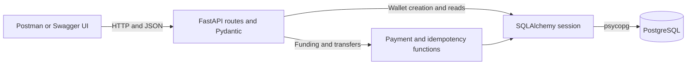

# LedgerPay

LedgerPay is a Python backend for a simulated INR wallet. Create wallets, add simulated funds, transfer money between wallets, and inspect the resulting history. PostgreSQL transactions keep the debit, credit, and records together. An idempotency key lets a client retry a funding or transfer request after losing the response.

**Stack** · Python 3.12, FastAPI, Pydantic v2, synchronous SQLAlchemy 2, PostgreSQL, psycopg, Uvicorn, python-dotenv, pytest, HTTPX, Ruff, and Postman.

## Run on Windows

If you already have `.venv`, `.env`, and the database tables, skip to [Start the API](#start-the-api).

For a fresh setup, install Python 3.12 and PostgreSQL. The example uses PostgreSQL 18 on port 5432. Adjust the path to match your installation. [PostgreSQL Windows installers](https://www.postgresql.org/download/windows/)

### Create the databases

Open `psql` using the administrator account you set up with PostgreSQL.

```powershell
& "C:\Program Files\PostgreSQL\18\bin\psql.exe" -h 127.0.0.1 -U postgres -d postgres
```

In `psql`, create a role and database for the API. The last two commands prevent other ordinary roles from connecting through the default `PUBLIC` grant.

```sql
CREATE ROLE ledgerpay_app LOGIN;
\password ledgerpay_app
CREATE DATABASE ledgerpay OWNER ledgerpay_app;
REVOKE CONNECT ON DATABASE ledgerpay FROM PUBLIC;
GRANT CONNECT ON DATABASE ledgerpay TO ledgerpay_app;
```

For the test suite, create a separate role and database in the same `psql` session.

```sql
CREATE ROLE ledgerpay_tester LOGIN;
\password ledgerpay_tester
CREATE DATABASE ledgerpay_test OWNER ledgerpay_tester;
REVOKE CONNECT ON DATABASE ledgerpay_test FROM PUBLIC;
GRANT CONNECT ON DATABASE ledgerpay_test TO ledgerpay_tester;
\q
```

### Configure the API

From the project folder, run the following.

```powershell
py -3.12 -m venv .venv
.\.venv\Scripts\python.exe -m pip install -r requirements.txt
Copy-Item .env.example .env
notepad .env
```

Replace `CHANGE_ME` in `DATABASE_URL` with the app role's URL-encoded password. Uncomment `TEST_DATABASE_URL` and replace its placeholder if you created the test database. Set the host and port in both URLs if they differ. For example, a literal `@` in a password must be encoded as `%40`. The app reads exported environment variables first and uses `.env` for unset values. Keep `.env` private.

```powershell
.\.venv\Scripts\python.exe -m app.database
```

This creates missing tables. You can run it again against the same database.

### Start the API

Open the VS Code terminal in the project folder and run:

```powershell
.\.venv\Scripts\python.exe -m uvicorn app.main:app --host 127.0.0.1 --port 8000 --reload
```

Open [Swagger UI](http://127.0.0.1:8000/docs), expand an endpoint, and use **Try it out** to send a request. FastAPI serves the machine-readable contract at [OpenAPI JSON](http://127.0.0.1:8000/openapi.json).

## API reference

The payment and wallet routes use the prefix `/api/v1`.

| Method | Path | Success | Action |
| --- | --- | --- | --- |
| GET | `/health` | 200 | Check whether the process responds |
| POST | `/api/v1/wallets` | 201 | Create a zero-balance wallet |
| GET | `/api/v1/wallets` | 200 | List wallets in ID order |
| GET | `/api/v1/wallets/{wallet_id}` | 200 | Read a wallet |
| GET | `/api/v1/wallets/{wallet_id}/balance` | 200 | Read the current balance |
| POST | `/api/v1/wallets/{wallet_id}/fund` | 201 | Add simulated funds |
| POST | `/api/v1/transfers` | 201 | Move funds between two wallets |
| GET | `/api/v1/transfers/{transfer_id}` | 200 | Read a completed transfer |
| GET | `/api/v1/wallets/{wallet_id}/transactions?limit=20&offset=0` | 200 | Read history in descending transaction ID order |

Owner names are trimmed and must contain 1 to 100 characters. All amounts and balances are integer INR paise. For example, ₹25.50 is `2550`. Requests accept amounts from `1` through `9007199254740991`. Balances can also be zero. The limit fits PostgreSQL `BIGINT` and the exact integer range of JavaScript clients.

Funding and transfer requests require both headers below. Use a fresh key for each new payment and reuse it if that payment needs a retry. Both header values are case-sensitive and allow ASCII letters, digits, periods, underscores, colons, and hyphens. The client ID allows 1 to 64 characters and the key allows 1 to 128.

```http
X-Demo-Client: local-demo
Idempotency-Key: a-unique-key-for-this-payment
```

### Example requests

Create two wallets by posting `{"owner_name":"Asha"}` and `{"owner_name":"Ravi"}` to `/api/v1/wallets` with `Content-Type: application/json`. The first response looks like this.

```json
{"id":1,"owner_name":"Asha","balance_paise":0,"currency":"INR","created_at":"2026-11-09T10:00:00Z"}
```

Use the returned IDs in subsequent calls. For a sender with ID `1`, post to `/api/v1/wallets/1/fund` with the two payment headers and `{"amount_paise":100000}`. The response includes the history record ID, the balance at the time of funding, and `"simulated":true`.

Transfer ₹500 by posting this body to `/api/v1/transfers` with the same client ID and a new key.

```json
{"sender_wallet_id":1,"receiver_wallet_id":2,"amount_paise":50000}
```

Example `201 Created` response.

```json
{"id":1,"sender_wallet_id":1,"receiver_wallet_id":2,"amount_paise":50000,"currency":"INR","status":"completed","created_at":"2026-11-09T10:01:00Z"}
```

`GET /api/v1/wallets/1/balance` now returns `{"wallet_id":1,"balance_paise":50000,"currency":"INR"}`. The sender history includes a `transfer_out` row and a `fund` row. The receiver history includes a `transfer_in` row. History amounts are positive and the kind tells you the direction. Each entry includes `balance_after_paise`. Use `limit` from 1 to 100 and a nonnegative `offset`.

### Retries and errors

| Situation | Result |
| --- | --- |
| Successful payment repeated with the same client, operation, key and payload | Original `201` and original JSON |
| Same client, operation and key after success, with a changed valid payload | `409 idempotency_conflict` |
| Simultaneous duplicate | Waits on PostgreSQL. Replays or conflicts after commit. If the first transaction rolls back, the waiting request can reserve the key. |
| Invalid body, ID, query parameter, or payment header | `422 validation_error`. The request can be corrected and sent with the same key. |
| Unknown wallet or transfer | `404 wallet_not_found` or `404 transfer_not_found` |
| Insufficient balance or credit above the cap | `409 insufficient_funds` or `409 balance_limit`. The transaction rolls back, leaving the key available. |
| Transient database failure, such as a lock timeout | `503 database_unavailable`. Retry the same payload with the same key. |
| Unexpected database failure | `500 database_error`. For an unknown commit outcome, retry with the same key to recover the committed result if present. |

Errors have a consistent envelope. Validation errors also include `error.details` with field locations and messages.

```json
{"error":{"code":"insufficient_funds","message":"Sender has insufficient funds."}}
```

`X-Demo-Client` is caller-chosen and serves only as a local namespace. The key scope is `(client ID, operation, key)`. Funding includes the wallet ID in its payload hash. Anyone who can access the service can choose any client ID and operate on any wallet. Use it on localhost for the demo.

## Postman walkthrough

1. Import [LedgerPay.postman_collection.json](LedgerPay.postman_collection.json) into Postman.
2. Leave `baseUrl` at `http://127.0.0.1:8000` unless you started Uvicorn elsewhere.
3. Run the collection in order. The create requests capture the wallet IDs. The funding and transfer requests generate new keys. The replay requests reuse those keys and compare responses.
4. Inspect the conflict example and the final balances. The sender and receiver each have `50000` paise after the transfer. Running the entire collection again creates two fresh wallets.

For individual calls, run the create requests first. Use the named **Replay funding** or **Replay transfer** request to retry. The original requests generate fresh keys by design.

## Architecture



| Table | Purpose and key fields |
| --- | --- |
| `wallets` | Primary key `id`, owner name, `BIGINT` balance, and creation timestamp. A check constraint enforces the balance range. |
| `transfers` | Primary key `id`, two wallet foreign keys, positive amount, `completed` status, and creation timestamp. A check requires distinct wallets. |
| `wallet_transactions` | Primary key `id`, wallet foreign key, optional transfer foreign key, kind, positive amount, resulting balance, and timestamp. An index on `(wallet_id, id)` serves history reads. |
| `idempotency_records` | Composite primary key `(client_id, operation, key)`, SHA-256 request hash, original response JSON, and creation timestamp. Successful writes and their replay data commit together. |

Read [Architecture and milestone walkthrough](docs/architecture.md) to trace the Python code and database statements. Use the [Interview guide](docs/interview-guide.md) to practice explaining the design.

## Run tests

With PostgreSQL running and `TEST_DATABASE_URL` configured, use these commands.

```powershell
.\.venv\Scripts\python.exe -m pytest -q
.\.venv\Scripts\ruff.exe check app tests
.\.venv\Scripts\ruff.exe format --check app tests
```

The suite uses FastAPI TestClient with HTTPX and real PostgreSQL. Tests create fresh per-test schemas inside `ledgerpay_test` and drop only those schemas. The fixture checks the configured and actual database names before creating a test schema. The liveness and Swagger test runs without a database connection. Integration tests report skips if `TEST_DATABASE_URL` is absent.

## Troubleshooting

| Symptom | What to check |
| --- | --- |
| `py -3.12` is unavailable | Install Python 3.12 with its launcher or run the Python 3.12 executable directly with `-m venv .venv`. |
| PostgreSQL connection fails | Check that the PostgreSQL Windows service is running. Verify host, port, database name, password encoding, and the `postgresql+psycopg://` driver prefix. |
| Health works but database routes fail | `/health` checks process liveness. Run `python -m app.database` with the same environment used by Uvicorn to create tables and check the connection. |
| Funding or transfer returns 422 | Check both headers, integer amounts, and distinct wallet IDs. Use the field locations in the response. |
| A retry returns an older balance | Funding replays the response from its original commit. Read the current value with `GET /api/v1/wallets/{wallet_id}/balance`. |
| Integration tests skip | Set `TEST_DATABASE_URL` to the dedicated `ledgerpay_test` database. Its role needs permission to create schemas there. |

## Limitations

- All money movement is simulated. The app handles INR only and has no banking, card, or external payment integration.
- Wallets and caller-chosen client IDs have no authentication or authorization. Keep the API local.
- History records explain each wallet's balance changes. They form a simple activity log, without accounting accounts or reconciliation.
- Successful idempotency records remain for the lifetime of the database. The service has no retention or cleanup job.
- History pages can shift when new rows arrive between offset-based requests. Wallet listing is intended for a small demo dataset.
- Schema setup creates missing tables. Schema changes require explicit database updates.
